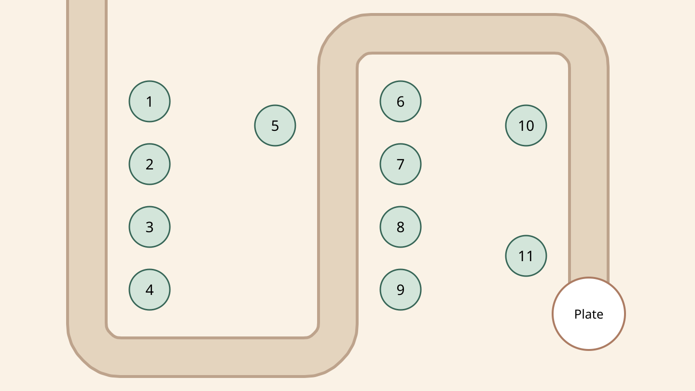
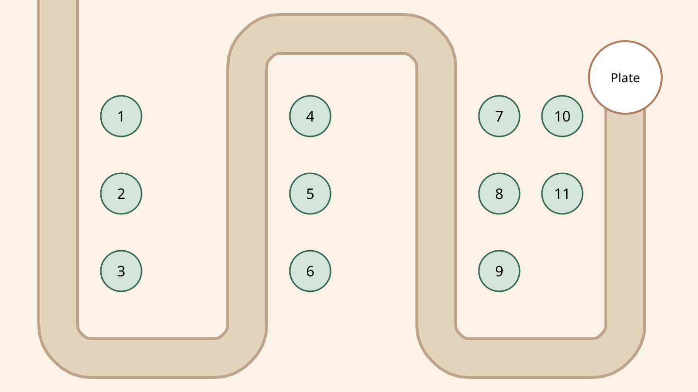
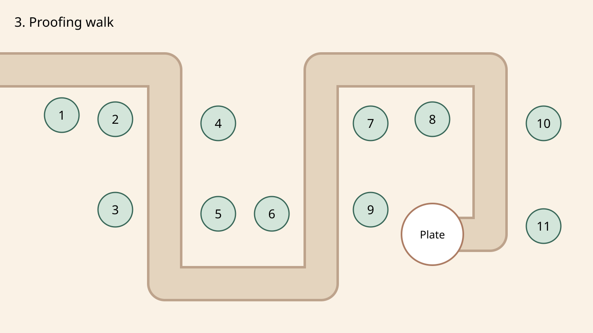

# 保卫大面包 — L1 engine v5

Pure deterministic TypeScript, shared by client saves and authoritative server replay.
No DOM, clock, photos, frame delta, or global randomness enters simulation. The server
continues deriving the weekly level from the same Monday and level number.

## Inputs, versions and saves

Canonical seed: `v5.td.<Monday YYYY-MM-DD>.<positive level>`. Versions 1–4 runs and saves
are rejected. `TD_ENGINE_VERSION` also drives the existing save key and server gate.
Pass either `{ seed, tierCount }` or `{ level: tdLevel(week, n), tierCount }` to
`createTdGame`; descriptors are regenerated from their seed, never trusted.
`replayTd(options, inputs, endTick)` reconstructs the same detached snapshot.

Inputs have exact keys, safe integer ticks (0–18000), and slots 0–10:

```ts
{ tick: 0, type: 'place', slot: 0, tower: 'rollingPin' }
{ tick: 0, type: 'upgrade', slot: 0 } // tier 0 -> 1
{ tick: 0, type: 'upgrade', slot: 0, branch: 'a' } // tier 1 -> 2
{ tick: 0, type: 'sell', slot: 0 }
{ tick: 0, type: 'callWave', slot: -1 }
```

Branch is required only for the second upgrade; supplying it earlier is rejected.
There is no hero skill. Sell refunds half the total spend, floored. Upgrade retains
the current cooldown. A sold tower's existing shots and burns remain active.
Malformed inputs do not advance time; legal-shaped rejected actions advance first.
Replay validates the entire log, including its tail, before simulation. Limits remain
2000 inputs, 120 ignored actions, five minutes, 60 ticks/second. Same-tick log order
matters. UI speed multipliers only change how often callers advance the engine. Server wall-clock
plausibility accepts up to 3×, with the existing 10-second slack and prefix checks.

## Bread and waves

Ten pieces start in the pile, with tier `floor(i * (tierCount - 1) / 9)` and ascending
price order. Endpoint arrivals take the highest remaining tier and turn around.
Carriers travel toward spawn at 80% speed, also affected by ground slow. Arriving at
an empty pile still makes a pest return empty. Returning pests never collect drops.
Only a carrier exiting spawn loses bread. `bread` means **all not-lost pieces**;
`breadTiers` is the pile only, `dropped` holds rolling pieces, `carriedTiers` belongs
to each pest, and `lost` counts exited pieces. Their sum is always ten.

A killed carrier drops its entire stack at its current path position. Each piece
rolls toward the endpoint at `BREAD_ROLL_SPEED = 64` movement subunits/tick, then
rejoins the sorted pile. Movement uses 16 subunits per field unit. All arithmetic
and snapshots use integers. Failure occurs at ten lost pieces (or timeout). Passing
requires all five waves complete, no living pests, and ≥1 bread (including drops
still rolling home).

Wave five contains exactly one **大胃王鼠**: `kind: 'mouse', boss: true`, speed 20,
armor 8, bounty 80, HP `600 + 180 * min(level - 1, 999)`. It takes up to three highest
remaining breads at once and drops the complete stack if killed.

`nextWave` is `{ index, counts: { ant, mouse, sparrow, beetle, boss } }`, or `null`
after wave five starts / game over. Boss is counted separately from ordinary mice.
`waveTargetTier` is the most expensive pile tier when the wave starts, or -1 if empty.
Waves auto-start after 600 prep ticks; calling early awards three coins per whole
remaining second. The next prep period starts when the current wave finishes spawning.

## Combat and drawing contract

The three maps use a 1440 × 810 landscape field, with longer winding routes entering
from the left and ending at an inset plate position. Each has eleven
spaced slots; every slot covers path within the shortest base tower range (150).
`TD_SLOT_RADIUS = 42` remains a 21 CSS-pixel radius at a 720-pixel-wide board.
Map rotation remains `floor((level - 1) / 4) % 3`.
Damage towers retain their previous tier stats. Sifters slow by 40% / 50% / 60% and
chip ground pests for 6 / 10 / 16 DPS, ignoring armor. Integer accumulation preserves
exact DPS without fractional HP. Tier 2 adds these branch effects:

| Tower | a | b |
| --- | --- | --- |
| Rolling pin | Two armored hits per attack | Push target 48 field units against its travel direction |
| Flour sifter | 65% ground slow, retained for 1 second after leaving the aura | 310-unit aura |
| Whisk | 140-unit splash | 24-tick attack interval |
| Oven | 16 damage every 30 ticks for 180 ticks; refreshes without stacking | 430 range and two extra targets in a 40-unit half-width, 150-unit continuation corridor |

Sparrows ignore flour auras. Only the strongest slow and chip rate apply, including overlapping auras and lingering
coating. Coating persists after selling the source too. Armor subtracts per
hit (minimum one damage). Stable targeting prefers greatest path distance, then
oldest pest ID; towers fire in slot order. Projectile stats are fixed at firing.

Pests expose `x`, `y`, `heading` (screen degrees, 0=right, 90=down), `hp`, `maxHp`,
`carrying`, `carriedTiers`, `slowed`, `returning`, and optional `boss: true`.
Towers expose `kind`, `tier`, `branch` (null before tier 2), `slot`, `target` (pest ID
or null), `cooldownProgress` (integer 0–100, 100=ready), `lastAttackTick` (null before
first shot), plus retained `level`, position, spend and ready-tick fields.

Drawing events include:

- `hit { pest, tower, damage, projectile }` (`tower` is its slot; burn/flour projectile is 0).
- `kill { pest, bounty, x, y }`.
- `pickup`, `drop`, `lose { pest, tiers, x, y }`; `recover { bread, tier, x, y }`.
- `place`, `upgrade { slot, tower, tier, branch }`, `sell { slot, refund }`.
- `waveStart { wave, targetTier, bonus }`, `bossSpawn { pest, wave }`, plus spawn/shot/over.

Every event also has `tick`. Events and nested arrays are detached from engine state.
`step` / `apply` return or expose only that operation's events; reading does not drain
or advance anything. Do not consume both returned and snapshot event batches.
Per tick: timeout, start/spawn, recover rolling bread, move/pickup/lose, flour chip damage, burn damage,
projectile impacts, tower attacks, clear check. Spawn exit beats damage on the same tick.

## Calibration and verification

`tests/support/tdBot.ts` uses public geometry/stats and a 2 Hz purchase cadence. It
scores damage coverage per coin, saves for the best next purchase instead of spending
every 60 coins on a cheap filler tower, chooses between both branches, values flour
chip DPS and nearby ground-tower support, and calls the next wave early only when no pests remain. Random purchases use
a deterministic independent RNG and choose branches too. Tuning uses 100 Monday seeds
starting 2026-01-05; a second disjoint regression window uses the following 100 Mondays.

Measured v5 greedy passes (100 weeks per window):

| Level | Window A | Window B |
| --- | ---: | ---: |
| 1 | 100% | 100% |
| 3 | 75% | 64% |
| 10 | 27% | 22% |
| 20 | 7% | 7% |

Every checkpoint's greedy runs built a sifter. Random passes were 0% / 0% at
L3 and L10, and 2% / 1% at L20. The separate 100-week L2 check passed 3%.

The regression gates are ≥95%, 60–80%, 20–40%, and 5–10% respectively in **both**
windows, with random ≤3% from L2 and sifter purchases in ≥90% of greedy runs. HP growth is `79 + floor(min(10, max(0, level - 10)) * 14 / 10)`;
normal pest HP uses that growth with level, wave and seeded weekly pressure. L2–L9
also receive a tapering early mixed-swarm pressure (see `earlyPressure` in `level.ts`).
Pest count grows by 1.5 per level, capped at 96 per wave; sparrows and beetles appear
at L4 and L5 respectively. Bounties fall by one coin every three levels, capped at four fewer coins at L13.
Boss rewards remain 80. Opening
coins start at 300, with a temporary combo allowance peaking at +100 in L10
and tapering by 20 coins per level on either side. The late ramp adds 102 per
level from L11 through L20, capped at 1020 extra.
The regression requires sifters in at least 90% of greedy runs. Random L1 play remains
deliberately forgiving; later levels reward tower choices.

Run `npx vitest run --configLoader runner --project unit --maxWorkers 1`, `npx tsc --noEmit`,
`npm run lint`, and `npx vitest run --configLoader runner --project db` (only a
validated `*_test` database). E2E fixtures use the current seed and branch-aware bot;
no browser is required for this backend change.

## L1 level-design pass

Coordinates below are authoritative field units. Numbered markers are **1-based**
(engine inputs remain 0–10). Slot centers are at least 126 apart, at least 103
from a route centerline (60 beyond its 43-unit outer edge), and slot rims have
60 units of board clearance. The plate is 40 units back from the last vertex;
all slot centers stay at least 120 away. Map edges are only crossed at spawn.



Cooling rack is a broad S: 1–3 teach early coverage, 4–5 cover the first turn,
6 guards the plate approach, 7 and 11 cover the lower hairpin, 8–9 cover the
return straight, and 10 joins the final choke. Sifter plus whisk at the hairpin
trades early damage for a second firing opportunity; ovens can reach the other arm.



Dough folds circles inward: 1 covers entry, 2–4 cover the top traversal,
5–6 the outer descent, 7–8 the bottom turn, 9–10 the inner hairpin,
and 3 also guards the plate. 11 catches returning thieves at the entrance.
The central space now carries the final route and plate instead of being dead space.



Proofing walk uses a long vertical switchback: 1–2 are entry positions,
3–5 defend the first descent, 6 is the double-arm choke, 7–8 cover the climb
and top turn, 10–11 defend the final descent and 9 is the plate guard.
The central pair rewards slow plus splash; the right-side guards cover late leaks.

The five-level curriculum introduces ants in L1, mice in L2, ant/mouse mixes in
L3, sparrows in L4, and armored beetles in L5. Sparrows **follow the route but
ignore flour slow/chip**, retaining a readable single route and existing drawing
contract. Each level uses demonstration squads, pressure, interleaved combinations,
a smaller/slower recovery wave, then a mixed finale with exactly one boss.
The existing ten-second spawn-free preparation interval remains; players can call
it early for coins. Later finales alternate speed and armor instead of randomly
turning into a single-species wave. Weekly randomness changes pressure and support
waves without hiding a new species.

Beetle armor starts at 6 in L5, rises by 10 per level, and caps at 54. Their HP is
20% of the ordinary species curve: shells punish repeated small hits without
turning the wave into a slow damage sponge. Flour chip ignores armor and ovens
retain their large single-hit advantage; unarmored fast escorts still need coverage.

The HP anchors follow the map rotation's firing windows. Each new map gets an
approach level before pressure rises; returning to the broad S at L13 no longer
resets the difficulty. Intermediate levels were also probed, including the first
flyer lesson and the end of each four-level map block. This is a tuning curve,
not a promise that every player's win rate decreases at each individual level.

`tests/unit/levelDesign.test.ts` verifies the same early RUN inputs in both engine
modes, TD geometry and teaching order, recovery-wave pacing, mature RUN phrases,
and failure of each single-tower strategy at L10/L20 on the regression week.

Final offline validation: TypeScript and ESLint passed; all 1,181 unit tests
passed (including both 100-week windows and the L2 check). All 828 DB tests
passed against `bunbunny_lvl_test`, with TD/RUN integration tests rerun after
fixture/version changes. Blender packing validated all 25 atlases / 43 frames
at 235,633 bytes. No browser was run and no frontend game files were edited.
